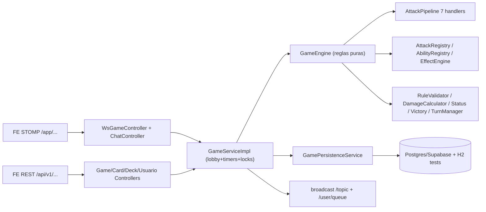

# TPI Pokémon — Backend Rebuild Spec (BE only)

> Alcance: solo `BE/`. FE queda fuera.
> Objetivo: documentar **qué hace** el backend actual, **cómo se comporta**, **falencias** y **mejoras** para rebuildear desde cero en otra carpeta.
> Fuente: lectura estática del repo al 2026-10-07. No se corrió build. Sin secretos en claro (maskeados).
> Base package: `ar.edu.utn.frc.tup.piii`

## 0. Stack y estructura

- `BE/pom.xml:6-19`: parent `spring-boot-starter-parent:4.0.0`, `java.version=21`, artifact `tpi-pokemon:0.0.1-SNAPSHOT`.
- Deps clave: `starter-web, -websocket, -data-jpa, -validation, -actuator, -security, -mail, -cache`, `springdoc-openapi-starter-webmvc-ui:2.8.0`, `jjwt:0.11.5`, `lombok:1.18.30`, `h2` + `postgresql(runtime)`, `modelmapper:3.1.1`, `mockito`, `jmh:1.37(test)`.
- Plugins: `checkstyle(check)`, `pmd`, `javadoc 3.6.0`, `owasp dependency-check 10.0.4 failBuildOnCVSS=7`, `jacoco` (bundle LINE 80%, `RuleValidator,StatusEffectManager,DamageCalculator` 90%).
- 215 `.java` en main, 70 en test. Total main ~15316 líneas.
- Clases más grandes (reales `wc -l`):
  - `services/impl/GameServiceImpl.java:1757`
  - `game/engine/GameEngine.java:1330`
  - `game/engine/AttackRegistry.java:937`
  - `services/GamePersistenceService.java:711`
  - `game/engine/effects/EffectEngine.java:636`
  - `services/impl/CardServiceImpl.java:624`
  - `services/impl/DeckServiceImpl.java:594`
  - `game/engine/AbilityRegistry.java:403`
- Paquetes: `configs/`, `controllers/` + `controllers/webSocket/`, `dtos/`, `entities/`, `game/engine/` + `pipeline/` + `effects/` + `events/`, `models/` + `enums/`, `repositories/`, `services/` + `impl/` + `JWT/` + `FilesManager/`, `websocket/`, `Application.java`.
- Sin `Dockerfile`, sin `docker-compose`, sin `.github/workflows`. Calidad solo local en `BE/.code_quality/`.
- Seed: `src/main/resources/data.sql:462` y `data-postgresql.sql:531` (mismo contenido, sintaxis H2 vs pg). Sin Flyway/Liquibase. Esquema vía `ddl-auto=update`.

## 1. Config y perfiles

- `src/main/resources/application.properties:58` (base, sin `context-path`):
  - `app.name/url`, springdoc `packages-to-scan=...controllers`, `swagger-ui.path=/swagger-ui.html`, `show-actuator=true`.
  - Datasource Supabase pooler `aws-1-sa-east-1.pooler.supabase.com:6543/postgres?sslmode=require` + user/pass **hardcodeados** (`:17-20`).
  - JPA: `PostgreSQLDialect`, `show-sql=true`, `ddl-auto=update`, `defer-datasource-initialization=true`, batch 50, `sql.init.mode=never`, `data-locations=data-postgresql.sql`.
  - Logging `root=INFO`, `piii=DEBUG`, `security=DEBUG`.
  - Mail Gmail `smtp.gmail.com:587` + user/app-password **hardcodeados** (`:49-50`).
  - `imgbb.api.key=***` (`:58`).
- `application-dev.properties:3`: `server.servlet.context-path=/api`, `sql.init.mode=always`.
- `application-prod.properties:1`: `server.servlet.context-path=/api`.
- Quirk: default/tests **sin** `/api`. Dev/prod **con** `/api`. `JwtAuthFilter` hace `replaceFirst("^/api","")`.
- `BE/.gitignore` no ignora `*.properties` / `.env`. `application.properties` trackeado.

## 2. Seguridad

### 2.1 SecurityConfig — `configs/SecurityConfig.java:118`
- `csrf.disable:40`, stateless, `JwtAuthFilter` antes de `UsernamePasswordAuthenticationFilter:70`.
- CORS `localhost:4200` only, `GET,POST,PUT,DELETE,OPTIONS,PATCH`, headers `Authorization,Content-Type`, `allowCredentials=true:76-96`.
- `permitAll:45-57`: `/swagger-ui.html`, `/swagger-ui/**`, `/v3/api-docs/**`, `/v1/usuarios/auth`, `/v1/usuarios/auth/token`, `/v1/password-recovery/**`, `/v1/locales/guests/**`, `/ws/**`, `DispatcherType.ASYNC`.
- Roles: `/v1/usuarios/usuario/**→ROLE_USER:59`, `/v1/usuarios/admin/**→ROLE_ADMIN:60` (sin controller que lo implemente), `/v1/deck/**→ROLE_USER:61`, `/v1/cartas/**→ROLE_USER:62`, resto `authenticated():64`.
- `v1/games/**` y `messages/**` caen en `anyRequest().authenticated()` (cualquier rol).
- `BCryptPasswordEncoder`, `DaoAuthenticationProvider(usuarioService)`.

### 2.2 JWT — `services/JWT/JwtService.java` + `JwtAuthFilter.java`
- `SECRET=***` hardcodeado `:19` (HS256, `Decoders.BASE64`).
- `horasDeToken=24:20`. `generateToken(roles,username,id)`: claims `{roles[], username}`, subject=`id`, exp 24h.
- `validateToken`: solo `username==userDetails.username && !expired:93-97`. No cruza `id` vs username. Roles se toman **del token**, no de DB (`JwtAuthFilter.java:56-61`). Token viejo conserva `ROLE_ADMIN`.
- `JwtAuthFilter.doFilterInternal:31-78`: bypass si `isPublicEndpoint` (stripea `/api`, `startsWith` swagger/auth/recovery/ws). Lee `Authorization: Bearer` con `substring(7)` (sin exigir espacio). Sin `AuthenticationEntryPoint` custom → 403 genérico en vez de 401.
- WS: `StompAuthChannelInterceptor:59-95` exige `Authorization: Bearer` en CONNECT, valida y setea `principal`. `preSend:42-57` solo intercepta CONNECT y SUBSCRIBE. `authorizeSubscription:97-112` **solo valida** `/topic/game/{id}/chat`; `state/lobby/action-result` abiertos a cualquier JWT (comentario `:124` lo admite). `extractUserId:131-140` usa `UserPrincipal.getId()` o `getName()`.
- `WebSocketHandshakeInterceptor:16-25` siempre `true`, solo extrae `gameId` si path `/ws/game/*/chat`. `/ws/**` `permitAll` → handshake abierto.

### 2.3 Comportamientos auth a preservar / corregir
Preservar: BCrypt, stateless, roles por authority, auth STOMP en CONNECT.
Corregir en rebuild: secretos a env, refresh + revocación (`jti`/blacklist), roles desde DB o revalidación corta, 401 vs 404 en login, authz por recurso (ver §12), SUBSCRIBE validado por membresía, rate-limit recovery e import.

## 3. REST API (paths sin `/api`; en dev/prod prepend `/api`)

### 3.1 Usuario — `controllers/UsuarioController.java:155` `@RequestMapping("v1/usuarios")`
- `POST v1/usuarios/auth` (pub, `@Valid` sin constraints): `CreateUsuarioRequest{username,email,password}` → `void`. Crea con password encoded + starters.
- `POST v1/usuarios/auth/token` (pub, sin `@Valid`): `LoginRequest{username,password}` → `String` JWT raw. `BadCredentials→404` (debe ser 401).
- `GET v1/usuarios/usuario/profile/{id}` (`ROLE_USER`): → `UsuarioDto`. **Sin check dueño**.
- `POST v1/usuarios/usuario/foto` (multipart `foto`) → `String` URL ImgBB. ID desde `SecurityContext→UserPrincipal`.
- `POST v1/usuarios/usuario/name` body `UsuarioDto` (usa `.username`) → `String`.
- Friends (`ROLE_USER`): `POST .../friends/request` body `UsuarioDto(.id=receptor)` → `FriendshipDto`; `POST .../friends/{id}/accept|reject`; `DELETE .../friends/{id}`; `GET .../friends`; `GET .../friends/pending`; `GET .../friends/search?q=`.

### 3.2 Cartas — `controllers/CardController.java` `"v1/cartas"` (`ROLE_USER`)
- `GET v1/cartas/todas` → `List<CartaDto>` (cache, sin paginar).
- `GET v1/cartas?nombre=&tipo=&page=0&size=20` → `Page<CartaDto>`. `size` sin cota.
- `GET v1/cartas/{id}` → `CartaDto`.
- `POST v1/cartas/importar` → `String`. Importa set XY1 externo, también scheduler lunes 00:00 + boot. **Debería ser ADMIN**.

### 3.3 Mazos — `controllers/DeckController.java` `"/v1/deck"` (`ROLE_USER`)
`getCurrentUserId()` via `UserPrincipal`, else `IllegalState`.
- `POST /v1/deck` `@Valid CreateDeckRequest{name,cards[]}` → `DeckDto`.
- `GET /v1/deck` → `List<DeckDto>`.
- `GET /v1/deck/{deckId}` → `DeckDto`.
- `PUT /v1/deck/{deckId}` `@Valid UpdateDeckRequest` → `DeckDto`.
- `DELETE /v1/deck/{deckId}` → void.
- `POST /v1/deck/{deckId}/cards` `@Valid AddCardToDeckRequest{cardId,quantity}` → `DeckDto`.
- `DELETE /v1/deck/{deckId}/cards/{cardId}` → `DeckDto`.
- `PUT /v1/deck/{deckId}/cards/{cardId}/quantity?quantity=` (sin `@Min`) → `DeckDto`.
- `GET /v1/deck/{deckId}/validate` → `DeckValidationDto{valid,errors[]}`.

### 3.4 Partidas — `controllers/GameController.java:134` `"v1/games"` (autenticado, FE usa STOMP, estos son “Postman-only”)
- `POST v1/games` body opcional `CreateGameRequest{deck:List<Card>,deckId}` (sin `@Valid`): prioridad `deckId>deck>vacío` → `201 CreateGameResponse`.
- `GET v1/games?filter=` → `List<GameListItem>`. Filtros: `todas/blank→IN_LOBBY`, `publicas/privadas`, `espectar→IN_LOBBY,SETUP,IN_PROGRESS + spectators`, otro → `GameStatus.valueOf`.
- `GET v1/games/my-active` → `CreateGameResponse` o `204`.
- `GET v1/games/{gameId}` → `CreateGameResponse`. **Sin membresía**.
- `GET v1/games/my-resumable` → `List<GameListItem>` (SETUP,IN_PROGRESS,PAUSED,RESUMING).
- `GET v1/games/{gameId}/resume-lobby` → `ResumeLobbyDto`.
- `POST v1/games/{gameId}/join` body opcional `JoinGameRequest` → `CreateGameResponse`.
- `POST v1/games/{gameId}/initialize` → `CreateGameResponse` (legacy manual).
- `POST v1/games/{gameId}/action` body `GameActionRequest` (sin `@Valid`) → `ActionResultResponse`.
- `GET v1/games/{gameId}/state` → `GameStateResponse` personalizado.
- `POST v1/games/{gameId}/check-password` body opcional `JoinLobbyRequest{password}` → void. No usa playerId.
- `GET v1/games/{gameId}/lobby` → `LobbyStateDto`. No pasa playerId.
- `GET v1/games/{gameId}/logs` → `List<GameLogDto>`.
- `SimpMessagingTemplate` inyectado sin uso.

### 3.5 Recovery — `controllers/PasswordRecoveryController.java` `"v1/password-recovery"` (público, `@Valid` real)
- `POST /request` `{email @Email @NotBlank}` → msg genérico. Enumera (404 si no existe), sin throttle.
- `POST /validate` `{token}` → `{valid,message}`.
- `POST /reset` `{token,newPassword>=8}` → msg. Token `UUID`, TTL 15min, borrado tras uso, guardado plaintext.

### 3.6 Mensajes — `controllers/FriendMessageController.java` `"v1/usuarios/usuario/messages"` (`ROLE_USER`)
- `POST /send` `@Valid SendMessageRequest{receiverId,content}` → `FriendMessageDto`.
- `GET /conversation?otherUserId=` → `List<FriendMessageDto>`.
- `GET /conversations` → `List<ConversationDto>`.
- `GET /unread-count` → `Integer`.
- `POST /mark-read?senderId=` → void.

## 4. WebSocket STOMP

`configs/WebSocketConfig.java`: endpoints `/ws/game/{gameId}/chat` + `/ws/friend-messages` (origen `localhost:4200`, sin SockJS). Broker `/topic,/queue`, prefix `/app`. FE usa `ws://.../ws` genérico — **no coincide**, hallazgo.

`WsGameController.java:208` (`/app` implícito):
- `/game/{id}/join` `{password?}` → `/topic/game/{id}/lobby`.
- `/settings` `UpdateGameSettingsRequest{isPublic,acceptsSpectators,password plaintext}` → lobby.
- `/select-deck` `{deckId}` → lobby.
- `/ready` → lobby (toggle, exige deck para ready=true; 2 ready → countdown 3s).
- `/remove-player` `{targetPlayerId}` (solo creador) → lobby.
- `/leave` → broadcast interno (`GAME_DELETED` si vacío else `PLAYER_LEFT`).
- `/initialize` → `/topic/.../state`.
- `/action` `GameActionRequest` → triple broadcast (ver flujo §5.3): 1) `/topic/.../action-result` (pendingChoice sanitizado `options=null,context=null`), 2) `/user/{u}/queue/game/{id}/state` personalizado por pid, 3) `/topic/.../state` con `pendingChoice=null` (espectadores).
- `/spectator-join` → `/topic/.../spectator` + state best-effort. Exige `acceptsSpectators`.
- `/resume-ready` → `/topic/.../resume-lobby`.
- `/reconnect` → delega.
- `@MessageExceptionHandler(Security,IllegalState,IllegalArg,NoSuchElem)→/user/queue/errors {message}`.

`ChatController.java` (`@Validated`): `/game/{id}/chat.send` (`@Valid {content @NotBlank}`) → `/topic/.../chat {content,senderId,ts}`, exige `assertPlayerInGame`; `/spectator-chat.send` → `/topic/.../spectator-chat`, exige `assertPlayerOrSpectator`.

`SessionTracker:ConcurrentHashMap`, `DisconnectEventListener→handlePlayerDisconnect`, `UserLookupCache ThreadLocal` para usernames en broadcast.

## 5. DTOs y enums (contrato a replicar)

DTOs `dtos/game/` (27): `ActionResultResponse{success,message,state,pendingChoice,events,targetPlayerId,coinFlip}`, `GameStateResponse{gameId,status,currentPlayerIndex,turnNumber,phase,players[],playerNames{},myBoard,opponentBoard,turnLog[],winner,pendingChoice,currentSetupPlayerIndex,startingPlayerIndex,disconnectTimerSeconds,mulliganCounts[],stadiumCard,spectator,gameStartTimestamp,turnStartTimestamp,playerElapsedSeconds[2],pauseStartTimestamp}`, `BoardDto{activePokemon,bench[],hand:Object,deck:int,prizeCards:int,discardPile:int}` (conteos, no listas), `GameActionRequest{type:String(!),cardId,targetPokemonId,attack:Attack,energiesToDiscard[],choiceId,selectedOptionIds[],abilityName}` (`type` String libre, no enum), `CreateGameRequest{deck:List<Card>,deckId}`, `CreateGameResponse{gameId,players[],status,winnerId,creatorId,createdAt,updatedAt}`, `LobbyStateDto{gameId,creatorId,players[],countdownActive,countdownEndsAt,event,isPublic,acceptsSpectators}`, `ResumeLobbyDto` similar, `HandCardDto`, `PokemonInPlayDto`, `PokemonCardViewDto`, `AttackViewDto`, `AbilityViewDto`, `EnergyChipDto`, `ToolChipDto`, `CoinFlipEventDTO`, `PlayerDto`, `GameListItem`, `GameLogDto`, `SelectDeckRequest{deckId}`, `RemovePlayerRequest{targetPlayerId}`, `UpdateGameSettingsRequest`, `JoinGameRequest`, `JoinLobbyRequest{password}` + `PendingChoice{choiceId,playerId,abilityName,promptLabel,options[],context{}}`, `ChoiceOption{optionId,label,imageUrl?}`.
Decks (8), cards (`CartaDto` manual + `api/PokemonTcg*` solo import), common `ErrorApi{timestamp,status,error,message}`, chat, recovery (email/token/password>=8), `CreateUsuarioRequest/LoginRequest` **sin constraints**, `UsuarioDto{id,username,email,fotoPerfil}`, `FriendshipDto{status:String}`.

Enums `models/enums/` (16): `GameActionType{PLAY_CARD,ATTACK,RETREAT,USE_ABILITY,PASS_TURN,DRAW_CARD,EVOLVE,ATTACH_ENERGY,PLAY_SUPPORTER,PLAY_STADIUM,ACTIVATE_ABILITY}`, `GameStatus{IN_LOBBY,SETUP,IN_PROGRESS,FINISHED,CANCELLED,PAUSED,RESUMING}`, `TurnPhase{DRAW,MAIN,ATTACK,END,BETWEEN_TURNS}` (`END` nunca usado), `Zone{HAND,DECK_PILE,DISCARD_PILE,PRIZE_CARDS}`, `Status{BURNED,POISONED,ASLEEP,PARALYZED,CONFUSED}`, `EffectType` 32 valores (ver §6), `EffectTarget` 8, `EffectTiming` 3, `AbilityType` 4, `Type` 11, `SuperType` 3, `SubType` 10, `SpecialEnergyType{RAINBOW,DOUBLE_COLORLESS}`, `ModifierType` 8, `ModifierDuration` 4, `FriendshipStatus` 4. `GameEvent` 13: `KNOCKOUT,PRIZE_TAKEN,SPECIAL_CONDITION_APPLIED,TURN_START,TURN_END,GAME_OVER,ENERGY_ATTACHED,EVOLUTION,RETREAT,MULLIGAN,SETUP_COMPLETE,GAME_START,ATTACK`.

## 6. Motor de juego (reglas a replicar exacto)

`GameEngine.java:86-1330`. `status==SETUP→GameSetupHandler`, `PAUSED→failure`, turno `players[current]!=player` (salvo `CONCEDE`), `pendingChoice` priorizado, `CANCEL_CHOICE` limpia, `RESOLVE_CHOICE` sin pendiente → failure. `ensureMainPhase` (DRAW auto, sino MAIN) y `ensureAttackPhase` (MAIN auto→ATTACK). Post-acción `persistence.saveGameState`.

- **Setup** (`GameSetupHandler.java:24-170` + `GameEngine:86-129`): valida 2 jugadores + `validateDeck` (60 exactas, ≥1 BASIC, max 4 copias por nombre salvo energía básica `special==null:151-154`). `initializeDeal`: copia, shuffle, roba 7. `handleMulligan`: sin BASIC → mano→mazo, roba 7, `mulliganCounts++`; rival roba 1 por cada mulligan. Coin flip primer jugador (heads=0). `PLACE_ACTIVE` (BASIC en mano, sin activo), `PLACE_BENCH` (<5), `CONFIRM_SETUP` (exige activo; P0→turno P1, P1→`finalizeSetup`: `initPrizeCards(sudden?1:6)` del tope, `IN_PROGRESS, turn=1, phase=DRAW, reset TurnManager`).
- **TurnManager.java:81**: `startTurn→DRAW`, `goToMain` desde DRAW, `canGoToAttack=MAIN && !primerTurnoInicial`, `endTurn`: acumula segundos, `firstTurn=false`, `BETWEEN_TURNS`, cambia jugador, `turn++`, `DRAW`. `shouldAutoDraw`: `!firstTurn` o no-inicial en turno 1. `processAutoDraw:1124-1141`: mazo vacío→FINISHED rival; sino roba 1 + `goToMain`. Primer turno inicial: no evoluciona (`RuleValidator:38-40`), no ataca (`:186-188`).
- **PLAY_POKEMON:278-300**: `canPlayPokemonToBench` (BASIC, activo primero, banca<5). Crea `PokemonInPlay(justPlayed=true)`.
- **EVOLVE:302-339**: no primer turno, no `justPlayed`, no STAGE2, `evolvesFrom==nombre`. Hereda daño/energías/tool/modifiers, cura estados, `justPlayed=true`. MEGA → `handleEndTurn` directo.
- **ATTACH_ENERGY:341-360**: max 1/turno. RAINBOW → +10 self.
- **PLAY_TRAINER:362-536**: `canPlayTrainer:67-108` (en mano, SUPPORTER 1/turno, STADIUM 1/turno, TOOL requiere target sin tool, Potion con target en juego, bloqueo `Forest's Curse` rival / `RESTRICT_ITEMS` propio / `supportersBlocked`). Pendings previos `createTrainerChoiceIfNeeded:648-765` (Max Revive ≥2 descartes, Evosoda 0/1/N evoluciones, Great Ball top-7, Cassius ≥2 en juego). Genérico: `hand.remove`, `TrainerEffectData.enrich`, `EffectEngine.apply` (Potion con source=target). Hardcodes: Super Potion (cura 60 + descarta 1), Roller Skates (flip→roba 3), Red Card (rival baraja y roba 4). Destino: SUPPORTER→descarte+contador, STADIUM→reemplaza+contadores, TOOL→`Hard Charm=DAMAGE_REDUCTION 20` / `Muscle Band=DAMAGE_BOOST 20` PERMANENT, resto→descarte.
- **RETREAT:767-826**: 1/turno, activo no ASLEEP/PARALYZED, no `NO_RETREAT`, `Fairy Garden+FAIRY` gratis (`StadiumEffectData:10-16`), sino `totalEnergy>=retreatCost` con `energiesToDiscard` (DCE=2). Swap con banca, cura al retirado.
- **ATTACK:829-911** orden real: `VAR_DMG→FLIP_FAIL(Hyper Fang)→EnergyValidation(total>=cost)→ConfusionCheck(tails=30 self+endTurn)→Selections→Prerequisites(ASLEEP/PARA/RESTRICT/cannotAttackUntil)→Modifiers(FLIP_COIN remueve efecto)→DamageCalc→PostEffects(EffectEngine+Spiky Shield 30)→COMPLEX→KO/DestinyBurst/premios→endTurn`. Pendings previos: bench-target (OPPONENT_BENCH/OWN_BENCH con banca) y Electron Crush yes/no (+30 descarta 1). `target null→activo rival`. KO: descarta energías/tool/carta, sube banca[0], atacante roba 1 premio (+1 si EX), `prize==0→FINISHED`, rival sin Pokémon→FINISHED.
- **USE_ABILITY:913-973**: 1/turno global, no ASLEEP/PARA, debe existir, `Fur Coat` pasiva→failure. 6 con handler (ver abajo), resto genérico EffectEngine.
- **END_TURN/CONCEDE**: `handleEndTurn:1069-1122` (limpia supporter-block, estados fin de turno propio + KO, `TURN_END`, `endTurn/startTurn`, `justPlayed` nuevo jugador, expira modifiers, autodraw, resetea contadores, victory→sudden/winner, `TURN_START`). `CONCEDE:1057-1067` anytime, rival gana.

**DamageCalculator.java:48-138**: attackerMods (+BOOST) → weakness (`*=mult default 2`, ignora `Mist Slash`, `Shadow Circle+DARKNESS` anula) → resistance (`-=|val| default 20`, ignora 4 ataques) → defenderMods (`-=REDUCTION`) → Fur Coat (-20). Floor 0. `counters=damage/10`. `TypeChart.java:55` **muerto**, no se usa.

**StatusEffectManager.java:126**: BURNED/POISONED acumulables, ASLEEP/CONFUSED/PARALYZED excluyentes. Sweet Veil (FAIRY+energía) inmune. `processBetweenTurns`: POISON 10, BURN tails 20, ASLEEP heads cura, PARA cura. ASLEEP/PARA bloquean ataque/retreat/habilidad. `cureOnBenchOrEvolve` limpia todo. Confusión pipeline 30.

**VictoryChecker.java:90**: premios ambos→sudden, P0/P1 sin premios→winner, mazos vacíos ambos→sudden, mazo vacío→rival, sin Pokémon→otro. `PRIZE=6` informativo. `startSuddenDeath:1254-1316`: todo al mazo, `SETUP`, roba 7, 1 premio.

**AttackRegistry.java:937** (4 mapas, sin switch): 21 VAR_DMG (Blaze Ball +20/FIRE, Hydro Pump +20/WATER, Colorful Wind +30/tipo, Evil Ball +20/energía total campo, Balloon Barrage +20/atacante, Circle Circuit +20/banca, Cosmic Spin +30 si Lunatone, Core Splash +30 si PSYCHIC, Tailspin +40 si defensor dañado, Bite Off +60 si EX, Wake-Up +60 si estado, Rage +10/contador propio, Second Bite +10/contador rival, Leaf Munch +20 si GRASS, Magma Mantle tope+50 si FIRE, Continuous Tumble caras×30, Spiny Rush caras×20, Rock Black caras×50 por FIGHTING, Charge Dash +20, Electron Crush +30 si discard, Seething Anger caras×30 por contadores). 1 FLIP_FAIL (Hyper Fang). 37 COMPLEX (Rapid Spin swap ambos, Splash Bomb tails 30 self, Conversion Powder ASLEEP/POISONED, Confusion Wave ambos, Night Claw descarta 2, Flare Blitz descarta FIRE, Fire Tail 1 FIRE, Flame Charge adjunta FIRE mazo, Energy Glide LIGHTNING + swap, Oblivion DARKNESS descarte→banca, Geomancy 2 FAIRY, Joust rompe tool, Y Cyclone/Tricky Steps/Energy Salon mueven energía, Spirit Scream deja 10HP ambos, Clamp PARA+descarta, Bounce swap heads, Hypno +30 y self ASLEEP, Recover descarta 1 cura todo, Dig Out tope cura 30, Seafaring busca energía heads, Lead Skiddo busca SUPPORTER, Clairvoyant top-3 log, Mine top rival log, Pickup 2 ITEM, Torment/Darkness/King's/X/Rock bloquean ataque hasta turn+1, Bother bloquea SUPPORTER, Moonblast REDUCTION 20, Metal BOOST 40, Charge Dash self 20, Astonish mano rival→mazo, Mad Mountain muele por contadores).

**AbilityRegistry.java:403** (6): Mystical Fire (roba hasta 6), Water Shuriken (descarta WATER mano, 30 a rival elegido), Upside-Down (evoluciona CONFUSED), Stance Change (swap Aegislash mano), Fairy Transfer (mueve FAIRY a banca), Drive Off (switch rival). Pasiva Fur Coat. Destiny Burst/Spiky Shield/Sweet Veil/Forest's Curse inline.

**EffectEngine.java:636** (31 handlers, FLIP_COIN vive en Modifiers): APPLY_STATUS, HEAL (amount/10), SELF_DAMAGE, DRAW, DISCARD_ENERGY (1), SHUFFLE_HAND, DISCARD_OPPONENT_HAND (deja N), DISCARD_HAND, SEARCH_ENERGY, HEAL_ALL, SWITCH_ACTIVE, SEARCH_POKEMON, REVIVE (Max Revive tope), DISCARD_DECK, PUT_COUNTERS (×10, ALL rival), DRAW_UNTIL, MOVE_ENERGY, OPP_SWITCH (banca[0]), DISCARD_ALL, REMOVE_STATUS, DRAW_SHUFFLE (Devastating Wind propio), DISCARD_OPP_DECK, HEAL_BENCH, PREVENT_RETREAT/RESTRICT_ATTACK/RESTRICT_ITEMS (UNTIL_NEXT_TURN), FLIP_STATUS/FLIP_ENERGY, PREVENT (9999), SEARCH_ANY, RECYCLE (1ª descarte). Trainers (`TrainerEffectData:26-64`): Potion 30, Tierno 3, Cilan 3, Letter 2, Sycamore descarta+7, Grunt descarta rival, Shauna 5, resto hardcode GameEngine.

**Models**: `GameState.java:30 campos` (ids, boards, contadores turno, `pendingChoice/pendingAttackAction/pendingTrainerCardId/attackBenchTarget/attackOptionalDiscard/supportersBlocked`, timestamps/elapsed/pause). `PlayerBoard.java:MAX_BENCH 5`, `initPrizeCards(n)` tope, `takePrize`. `PokemonInPlay.java:18-85` (`hpRemaining=hp-count*10`, `knockedOut`, **`addDamage` trunca `dmg/10`**, `totalEnergyCount` DCE=2, `discardAll`, condiciones, `cannotAttackUntilTurn`).

## 7. Servicios y persistencia

**GameServiceImpl.java:1757** (`@Service`, `newScheduledThreadPool(4)` sin shutdown, 10 `ConcurrentHashMap`, 9 deps): `createGame(player)` (IN_LOBBY+order1+engine vacío), `joinLobby` (cap 2, password plaintext, agrega a State), `selectDeck` (sin ownership check, `playerDecks.put(game:player{order})`, cancela countdown), `setPlayerReady` (toggle, exige deck, 2 ready→countdown 3s), `removePlayer` (solo creador), `leaveGame` (vacío→delete+`GAME_DELETED`), `getLobbyState`, `updateGameSettings` (solo creador), `initializeGame` legacy, `executeAction` (`@Transactional`, `synchronized(gameId.intern())`, valida jugador, bloquea si disconnect timer <15s, `valueOf(type)`, `engine.executeAction`, drena `eventQueues`, agrega evento ATTACK), `getState` (cache o `getOrCreateEngine`, espectador solo si allowed, fallback WAITING), `getGameLogs`, `listGames`, `getActiveGame`, `listMyResumable`, `getResumeLobby/setResumeReady` (PAUSED→RESUMING solo creador, countdown 3s `transactionTemplate`), `getGameById` (sin membresía), `checkPassword` (plaintext), `cleanupStaleGames` (`@Scheduled 1h`, borra IN_LOBBY >24h), legacy `create/join` con `List<Card>` o `deckId`, `handlePlayerDisconnect` (ignora espectador/fuera IN_PROGRESS/SETUP/PAUSED, 15s→PAUSED+persiste+`engines.remove`), `handlePlayerReconnect` (cancela, restaura, unpause ajustando timestamps). Privados: `startCountdown/initializeGameFromLobby` (valida 2 ready+decks, `engine.initializeGame`, SETUP, broadcast `GAME_STARTING`+state), `getOrCreateEngine` (cache o `loadGameState`), `buildGameAction/buildLobbyState/buildGameStateResponse/mappers`, `unpause/broadcast/registerEventListener`.

**GamePersistenceService.java:711**: `saveGameState` (`@Transactional`, try→Runtime) → `upsertGameEntity` (find o crea, setea status/turn/phase/sudden/índices/winner una vez/stadium/pending JSON/tiempos) → por player `upsertGamePlayer` (match user, flags boolean, `supporterBlockedUntil=turn+1`) + `syncPlayerCards` (zonas HAND/DECK/DISCARD/PRIZE, match por posición, delete+insert batch, skip carta inexistente) + `syncBoardPokemons` (**delete-all/insert-all** + `clearAttachedEnergies` nativo, position 0=activo) → `saveGameLog` (español, `PLAY_STADIUM` mapping). `loadGameState` reconstruye todo (players por order, cartas por zone, pokemons position 0=activo, `supportersBlocked` si `>=turn`, `currentIndex` por user, `turnLog` de logs). `serializePendingData` JSON TEXT `{pendingChoice,pendingAttackAction,youMayChoices}`. `convertCardEntityToModel` instanceof (null si desconocido).

Otros: **DeckService** (`validateQuantity>0`, `>4 copias` salvo básica, `total≤60`, lista exactamente 60 + ≥1 BASIC + conteo por nombre, persiste `isValid/version++`; starters agua/fuego-plant/psíquico-siniestro con mapa `xy1-NNN→qty`). **CardService** (`obtenerTodas(cache)`, `buscar(nombre,tipo,pageable)` filtra tipo en memoria, `buscarPorId`, `importar` externo `api.pokemontcg.io/v2/cards?q=set.id:xy1` + boot + lunes). **UsuarioService** (`UserDetailsService`, `crear` + starters, `cambiarNombre/Foto` via `FileManager.cutCompressUpload 128→ImgBB`, `loadUser` default ROLE_USER). **Friendship/FriendMessage** estándar. **Recovery** UUID TTL15 borra tras uso. **Email** JavaMail. **ImgBB** `POST api.imgbb.com/1/upload?key`.

**Entidades**: `games(id UUID,status,turnNumber,turnPhase,started/updated/finished,currentTurnPlayer/creator/winner ManyToOne,starting/setupIdx,suddenDeath,stadiumCard ManyToOne,pendingData TEXT,previousStatus,timestamps Long,elapsed×2,players OneToMany CASCADE+orphan,isPublic=true,acceptsSpectators=true,password plaintext,logs)`, `game_players(id,order,flags×5,blockedUntil,game/user/deck ManyToOne,boardPokemons/cards/logs OneToMany,ready)`, `game_player_cards(id,zone,position,gamePlayer/card ManyToOne)`, `board_pokemons(id,position,damageCounters,turnsInPlay,gamePlayer/pokemonCard ManyToOne,attachedEnergies ManyToMany join,attachedTool ManyToOne trainer,status OneToMany CASCADE,modifiers OneToMany CASCADE)`, `board_pokemon_modifiers(type,source,value,duration,turnApplied)`, `status_effects(status,appliedAtTurn)`, `game_logs(turn,action,result,createdAt,actionType,game/actingPlayer)`, `cards(id String xy1-NNN,name,supertype,subtypes[],rules[],setId,imageUrl JOINED)`, `pokemon_cards(type,hp,retreat,evolvesFrom,attacks/weak/res/abilities OneToMany)`, `energy_cards(energyType,special null=básica)`, `trainer_cards(solo id)`, `attacks(id UUID,name,desc,damage String,cost[] Type)`, `abilities`, `weakness(type,multiplier String)`, `resistance(type,reduction String)`, `decks(id,name,isValid,created,version,user ManyToOne,deckCards CASCADE)`, `deck_cards(quantity,deck/card)`, `usuarios(id,username,email,password BCrypt,roles[],fotoPerfil,relaciones)`, `friendships(requester/addressee,status String,unique par)`, `friend_messages(sender/receiver,content,read)`, `password_recovery(user,token,emitted)`. Fetch defaults (ManyToOne EAGER). Sin versionado optimista.

**Repos**: `BoardPokemon` + nativas delete join, `Card` `findByNameContainingIgnoreCase + findAllByIdIn`, `DeckCard` by deck+card, `Deck` by user/byIdAndUser/byNameAndUser + `DeckSummaryProjection`, `Friendship` JPQL user/pending/par, `GameLog` by game, `GamePlayerCard` by player/zone, `GamePlayer` by deck + `findActiveGameByUserId(statuses)`, `Game` by status/public/spectators/creator + JPQL by player, `Message` JPQL conversación/unread + `countByReceiverAndReadFalse`, `Recovery` by token/user, `Usuario` by email/username/like.

**Seed**: 4 usuarios (admin/user/hernan/hernan2 BCrypt), 146 `xy1-001..146`, `card_subtypes`, `pokemon(type,hp)` + `retreat=0` en 5 ids, 11 energías (DCE, RAINBOW, 9 básicas), 15 trainers solo id, 2 abilities + 2 attacks fallback + costs, 1 friendship ACCEPTED.

## 8. Errores, validación, concurrencia

`GlobalExceptionHandler.java:15-60` → `ErrorApi{timestamp,status,error,message}`: `IllegalArg→400`, `IllegalState→409` (discutible, muchos son 400), `Security→403`, `NoSuch→404`, `ResponseStatus→mismo`, `Exception→500` con `ex.getMessage()` crudo (leak SQL). Sin `MethodArgumentNotValid` → 400 default sin `ErrorApi`, sin `AccessDenied`.
`@Valid` efectivo: recovery (3), `SendMessage`, `ChatMessage`, `CreateDeck/Update/AddCard` (DTOs sin constraints → no-op), `crearUsuario` (sin constraints). Sin `@Valid`: login, `CreateGame/JoinGame/GameAction/JoinLobby`, `quantity`, `page/size`, todos `@Payload` WS.
Concurrencia: `synchronized(gameId.intern())×4:497,1041,1133,1254` single-instance, `intern()` fuga, `initializeGame:453` sin lock ni `@Transactional`. Estado lobby en memoria se pierde al restart. `Random` no `SecureRandom` (`CoinFlipService:10`, más `Math.random:908` en Astonish + `new CoinFlipService:36` oculto). `DamageCalculationHandler:26-29` set/unset estadio mutable (temporal coupling).
Observabilidad: `catch(Exception)×~20`, `RuntimeException×3` persistencia, `orElse(null)` hot paths, `return null×~15`, `catch //skip:137-139` WS, `printStackTrace` ImgBB, `System.out` comentados JWT, `show-sql=true` + `security=DEBUG` en base.

## 9. Build, tests, docs

`pom.xml:182-330`: checkstyle `FileLength max500:14-16` violado ×7, `MethodLength max60` ×12, PMD `ExcessiveImports>30` ×4 (`CardService 50`), `minimumTokens 100`. `springdoc 2.2.0` declarado pero usa `2.8.0`. `pmd 7.0.0-rc3` RC. `jjwt 0.11.5`, `lombok 1.18.30`, `modelmapper 3.1.1` abandonado. `test-autoconfigure/webmvc-test` redundantes con `starter-test`. JMH en test.
Jacoco excluye `Friendship*/Message*` que **sí** tienen tests → cobertura maquillada.
Tests 70: engine ~20 (GameEngineTest 3442 líneas monolítico, 2 EffectEngineTest solapados 512+1005, pipeline/setup incluidos), `GameServiceImplTest:1996` con `LENIENT` + reflexión, controllers finos (`GameControllerTest:173`), **sin** test `WsGameController` triple-broadcast/leak. Reglas jacoco 80/90% probablemente no se corren (sin CI).
Docs stale: `BE/README.md:3` dice Boot 3.x, árbol `engine/core,rules,calculator` inexistente, endpoints `/api/games` vs `v1/games`, WS `ws://.../api/ws/game/{id}` vs STOMP real, `application.yml` inexistente. `BE/docs/` solo `api-game-controllers.md` parcial. `docs/game-rules-summary.md` útil, `docs/game-setup-bug-fix-plan.md` en raíz no en BE. `AGENTS.md` “6 issues resueltas” no verificable.

## 10. Patrones y SOLID (para no repetir errores)

Reales: Facade (intento), CoR 7 handlers, Registry+Strategy (4 mapas Attack, 2 Ability, 31 Effect), DTO/Context (`AttackContext`,`EffectContext`,`GameState`), Builder nominal (`AttackPipelineBuilder` trivial).
Degradados: Facade→God, Builder sin variantes, CoR con 3 pasos fuera (VAR_DMG/FLIP_FAIL/COMPLEX).
SRP roto `GameEngine/GameServiceImpl`, OK en Validator/Victory/Modifier. OCP formal OK, práctico roto (catálogo en 1-2 archivos, claves String). DIP roto (`new` 9 colaboradores `:52-66`, estáticos globales, `Math.random`). Smells: God Object, Lava Flow (literales en ≥6 archivos), Copy-Paste (evolución×2, `remove(0)×~10`, `healed=min`×3), Magic (`9999,30,20,6`), Shotgun Surgery, Dead (`TypeChart,EnergyUtils vs totalEnergyCount,getPrizeRemaining vs getTotal,PRIZE const`), DataClass (`AttackContext,GameState` 30 campos por convención con Engine/Effect/Registry).

## 11. TECH_DEBT (priorizada)

| ID | Problema | Cat | Sev | Ubicación |
|----|----------|-----|-----|-----------|
| TD01 | 4 secretos en git (DB, Gmail, ImgBB, JWT) | Seguridad | Crítica | `application.properties:17-20,49-50,58`, `JwtService:19` |
| TD02 | Sin ownership mazos / lectura partidas / perfil / importar USER / SUBSCRIBE state | AuthZ | Alta | `GameServiceImpl:217,1652`, `GameController:54`, `UsuarioController:76`, `CardController:54`, `StompInterceptor:114` |
| TD03 | God Service 1757 + scheduler sin shutdown + 10 mapas memoria | Arq | Alta | `GameServiceImpl:43-1757:60-69` |
| TD04 | God Engine 1330 + switch + literales cartas | Arq | Alta | `GameEngine:132,362,538,648,829` |
| TD05 | `synchronized(intern())` + init sin lock, single-instance | Conc | Alta | `GameServiceImpl:497,1041,1133,1254,453` |
| TD06 | Persistencia delete-all/insert-all por acción, null posible | Perf | Media-Alta | `GamePersistenceService:274-303,319` |
| TD07 | `Ability.resolveChoice` 338 líneas, 7 clases >500, 12 métodos >60 | Mant | Alta | `AbilityRegistry:65-403`, `pom:184` |
| TD08 | `catch(Exception)×20`, `orElse(null)`, `return null×15`, leak `getMessage()` | Robust | Alta | `GamePersistence:92,384`, `GameService:408...`, `GlobalHandler:45` |
| TD09 | Validación ausente (login, GameAction, quantity, size, WS payloads) | API | Media | `Usuario:54`, `Game:29,95`, `Deck:70`, `Card:38` |
| TD10 | Broadcast WS frágil (sanitizar manual, perspectiva P0 en topic) | Seg | Media | `WsGameController:104-147`, `GameService:446` |
| TD11 | Sin CI, plugins huérfanos, pmd RC, deps viejas/modelmapper | Build | Alta | raíz sin `.github/`, `pom:20-26,73` |
| TD12 | Tests desbalanceados, mocks+reflexión, sin WS leak test, jacoco excluye con tests | Test | Media | `GameServiceTest:1996`, `GameEngineTest:3442` |
| TD13 | EAGER default + N+1, `ddl-auto=update` prod, `jakarta vs spring @Transactional` | Datos | Media | `GameEntity:74-105`, `app.props:26`, `DeckService:25` |
| TD14 | Recovery enumera + sin throttle, pass partida plaintext `equals` | Seg | Media | `Recovery:41`, `GameEntity:143`, `GameService:171,885` |
| TD15 | Docs stale, TypeChart muerto, EnergyUtils duplicado, magic numbers | Docs/Mant | Baja-Media | `BE/README:3`, `TypeChart:55`, `DamageCalc:512` |

## 12. RIESGOS (para rebuild)

| ID | Riesgo | Prob | Impacto | Mitigación rebuild |
|----|--------|------|---------|--------------------|
| R01 | Secretos expuestos reutilizados | Alta | Crítico | Rotar DB/Gmail/ImgBB/JWT, env/vault, reescribir historial o asumir |
| R02 | IDOR mazos/partidas/perfiles | Alta | Alto | `findByIdAndUserId`, membresía en cada `gameId`, tests IDOR |
| R03 | WS leak a espectadores | Media | Alto | DTOs separados `Public/Private/Spectator`, tests no-leak, authz SUBSCRIBE |
| R04 | Doble `executeAction` multi-instancia corrompe partida | Media | Alto | Lock DB `FOR UPDATE` + `version @Version`, idempotency-key |
| R05 | Pérdida lobby al restart | Alta | Medio | Persistir lobby/decks en DB, no solo memoria |
| R06 | Migración destructiva prod | Media | Alto | Flyway/Liquibase, `validate`, nada de `update` |
| R07 | Reglas TCG mal replicadas (truncado `dmg/10`, DCE=2, primer turno, MEGA) | Media | Alto | Tests parametrizados regla por regla desde §6 |
| R08 | `size=MAX` / `quantity` null DoS | Media | Medio | Paginación acotada, Bean Validation en todos los inputs |

## 13. Qué copiar / qué no copiar (rebuild)

**Copiar comportamiento (no código):** validar mazo 60/4/BASIC, setup 7+mulligan+6 premios (1 sudden), ciclo DRAW→MAIN→ATTACK, 1 energía/1 supporter/1 stadium/1 retreat/1 ability por turno, restricciones primer turno, MEGA end-turn, orden daño (boost→weak→res→reduction→FurCoat), 5 estados + Sweet Veil + cura banca/evolución, victoria premios→mazo→sin Pokémon + sudden, 21 VAR_DMG + 37 COMPLEX + 6 habilidades + 31 efectos (semántica §6), lobby 2 ready→countdown 3s, disconnect 15s→PAUSED, resume 3s, triple broadcast con sanitización, recovery 15min un uso.

**No copiar:** secretos en props, `intern()` lock, delete-all/insert-all, `type:String` libre (usar enum), `Board.hand:Object`, literales carta en engine, `Math.random`, `new` colaboradores (usar DI), estáticos globales no mockeables, `catch(Exception)` + `return null`, `getMessage()` crudo, EAGER implícito, `ddl-auto=update`, `@Valid` sin constraints, `404` login, password plaintext, `size` sin cota, `TypeChart` muerto, `END` sin uso, `isPublic=true` default (revisar), `SimpMessagingTemplate` sin uso en controller.

## 14. Roadmap rebuild (otra carpeta)

**F0 Seguridad y base:** env vars + rotación, Flyway baseline desde entidades §7, `validate`, paginación acotada, `GlobalExceptionHandler` sin leak + `MethodArgumentNotValid`, 401 login, hashing partida (`BCrypt` o al menos `SHA256+salt` + `MessageDigest.isEqual`), `SecureRandom`, CORS por perfil.
**F1 Dominio puro (TDD):** `GameState` inmutable/records + `RuleValidator/DamageCalculator/Status/Victory/TurnManager` con tests parametrizados (§6). `AttackRegistry/EffectEngine/AbilityRegistry` por composición (un archivo por carta/efecto, claves enum, no String). Eliminar `TypeChart` o usarlo de verdad. `addDamage` con resto documentado (no truncado silencioso).
**F2 Aplicación:** `LobbyService` separado de `GameExecutionService`, `DeckOwnership` check, `GameMembership` guard, lock `SELECT FOR UPDATE` + `@Version`, persistencia diferencial (upsert por posición, no delete-all), `GameLog` append-only, outbox para broadcasts.
**F3 Transporte:** REST versionado consistente (`/api/v1/...` plural inglés o español, no mezcla `cartas/games/deck`), DTOs `Create/Private/Spectator` separados, `@Valid` real en todos, WS `SEND` + `SUBSCRIBE` autorizados por membresía, `ActionRequest.type:enum`, tests IDOR + no-leak WS.
**F4 Ops:** `Dockerfile+compose`, CI (checkstyle/pmd/jacoco/owasp/test), Postgres local + Supabase solo prod, seed versionado (no `data.sql` con users admin fijos), observabilidad (logs sin PII, métricas actuator restringido).

## 15. Incertidumbres (no inventar)

- Password plaintext original de `admin` seed (solo hash `$2a$10$...` en repo) — asumir comprometido.
- `v1/locales/guests/**` sin controller visible — ¿módulo eliminado?
- `youMayChoices:Map` y `previousStatus` uso exacto fuera de persistencia — revisar en runtime.
- `stadiumCard` efectos completos (`Fairy Garden`, `Shadow Circle` confirmados; resto inferido de `StadiumEffectData`).
- Performance real (N+1, WAL bloat) — sin métricas prod, solo análisis estático.

---
*Generado para guiar rebuild desde cero. Si falta una regla, volver al `file:line` citado, no al recuerdo.*
